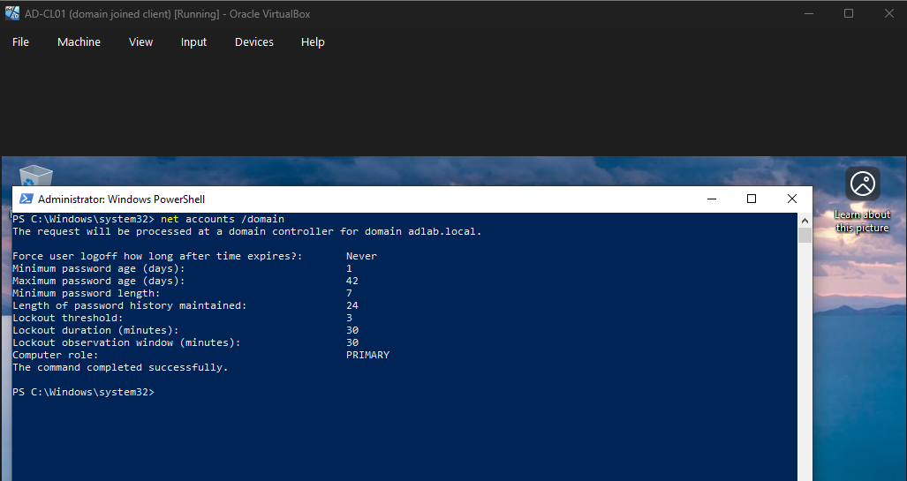
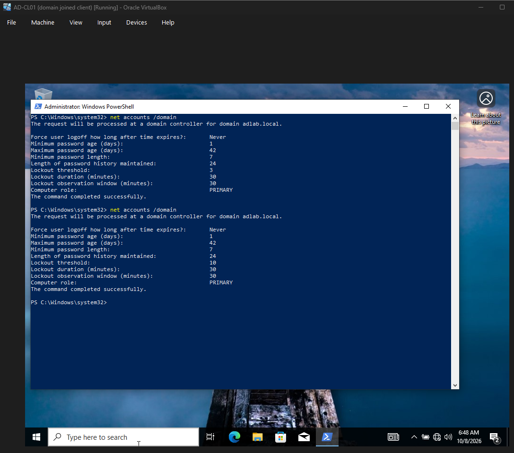

# CR-001 — Raise account lockout threshold from 3 to 10

| Field | Value |
|---|---|
| Requested by | J. Saraza (IT) |
| Implemented by | J. Saraza |
| Approved by | Self (lab). In production: |
| Date / window | 2026-10-08, |
| Change type | Normal |
| Risk | Low |
| Systems affected | AD-DC01: Default Domain Policy (Account Lockout Policy) |
| Users affected | all domain user accounts |

## Reason for change
User could possibly forget their password, causing them to reach out to unnecessarily reach out to IT, essentially wasting their time as opposed to saving time by allowing for up to 10 attempts on login.

## Current state (before), with evidence
Before the change, client accounts had a maximum of 3 attempts on login before being locked out. By running `net accounts /domain` on the admin powershell, it will return the lockout threshold. 

`net accounts /domain` on AD-CL01, 2026-10-08:

    Lockout threshold:                          3
    Lockout duration (minutes):                 30
    Lockout observation window (minutes):       30

## Implementation steps
1. Take a VirtualBox snapshot of AD-DC01 named `pre-CR-001`.
2. Group Policy Management → Default Domain Policy → Edit → Computer Configuration → Policies → Windows Settings → Security Settings → Account Policies → Account Lockout Policy.
3. Set Account lockout threshold to 10. Leave lockout duration and reset counter unchanged.
4. Run `gpupdate /force` on AD-DC01.
5. Run `net accounts /domain` on AD-CL01 and confirm the threshold reads 10.

## Backout plan
Rollback trigger:
Net accounts /domain shows anything other than threshold 10 with duration and window still at 30. Or the test account locks before 10 attempts. Or users report sign-in problems after the change.
Steps:
 1. Edit the Default Domain Policy, set the threshold back to 3, and run gpupdate /force on the DC.
 2. Run net accounts /domain on the client and confirm it shows 3
 3. Only if the GPO itself is broken, restore the pre-CR-001 snapshot.

Reverting the setting back changes one variable and tests to see if the changed setting was causing an issue. Rolling back to a previous snapshot can remove changes between that snapshot and the current state of the workstation that aren't intended to be reomved.

## Verification, from the user's side
**Test:** sign in to AD-CL01 as `tnguyen` with the wrong password 4 times, then with the correct password.
**Expected:** sign-in succeeds, and `Search-ADAccount -LockedOut` on AD-DC01 returns nothing.

**Result:**
Threshold before account gets locked out increases from 3 to 10

## Outcome 
Changed the amount of attempts the user gets before account is locked out, thereby increasing the margin for human error. This change request decreases the need for unneeded IT tickets, increasing IT efficiency and decreasing unimportant work.
