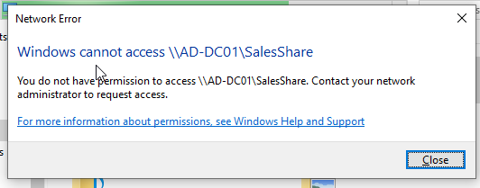
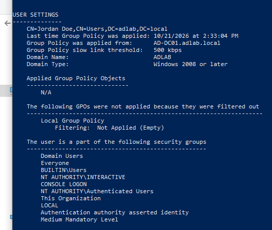
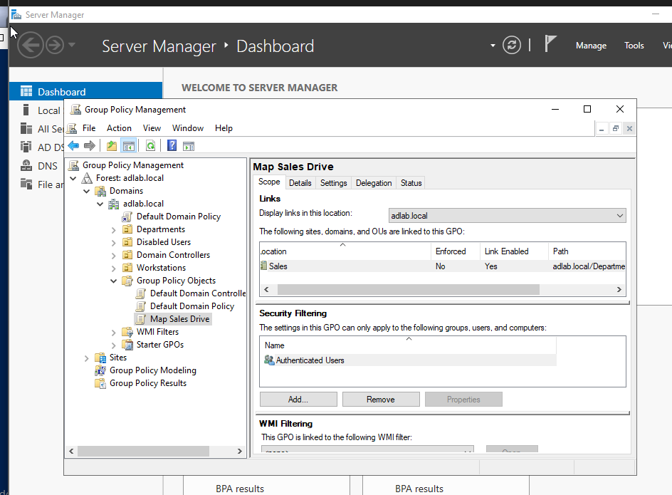

# TICKET-001 — Mapped drive missing after logon

| Field | Value |
|---|---|
| Priority | medium |
| Category | GPO |
| Reported by | John Doe (jdoe), Sales — new hire |
| Date | 2026-10-21 |
| Environment | Reproduced in lab: AD-DC01 (Server 2022), AD-CL01 (Windows 10) |

## Request
John Doe calls complaining that he does not have access to the S Sales drive.

## Diagnosis
First step is to login as jdoe to start diagnosing the issue.

1. Opened '\\AD-DC01\Sales' to first determine if jdoe has access to the drive at all. RESULT: "permission error". Rules out DNS or the network issue because the server answered.
 
  

2. Run 'gpresult /r' and look at the user settings. RESULT: Applied Under Group Policy Objects the Map Sales Drive is not listed and CN=Users, NOT Sales OU. Rules out a broken faulty drive. Leads us to believe that the issue is scope of GPO

  

3. Check the Group Policy Manager to verify the scope of Map Sales Drive. Found out that it is linked to the Sales OU only and not the User container, Jordan Doe is inside the User container and not the Sales OU .

      

## Actions taken
1. right click jdoe and move to departmemnts/sales
2. on the client side, sign out and sign back in because group policies are only applied on sign in's
3. check that the S drive appears and create test.txt and run 'gpresult /r' again to see Map Sales Drive listed. 

## Verification, from the user's side
S: drive appears in file explorer and user is finally able to access the S: drive and create a text file. Running 'gpresult /r' shows Map Sales Drive. 

## Resolution
Moving jdoe to the Sales OU allowed the group policy to apply to jdoe so that the shortcut to the S drive would appear.

## Notes / prevention
The root cause of this ticket was the faulty mapping of the group policy Map Sales Drive. The group policy was applied to the sales OU, however Jordan's account was inside the Users container. 

3 separate ways to prevent this ticket. 

1. Create new users by copying a template user. Instead of creating a new user from scratch, right click an existing user inside the OU and choose copy.
2. Add a checklist step. The onboarding checklist gets a line: "confirm the account is inside the OU department and then sign in as new user and check S: appears"
3. Make the drive map follow the group instead of the OU. Target the drive map at Sales-SharedDrive-Access not the OU so that all security group members automatically have access to the drive map.
