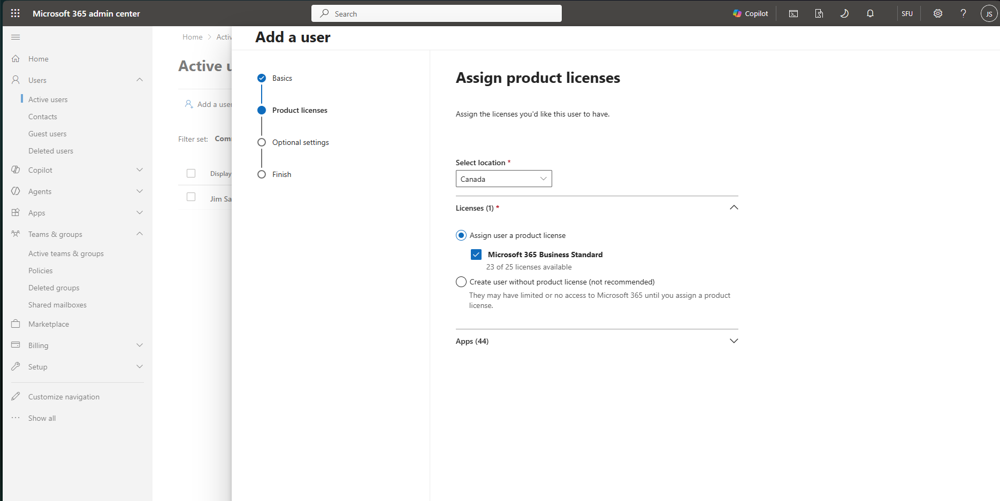
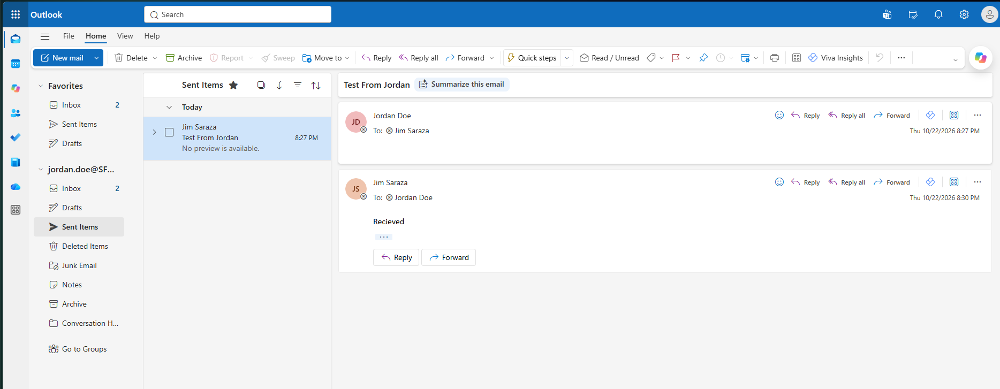
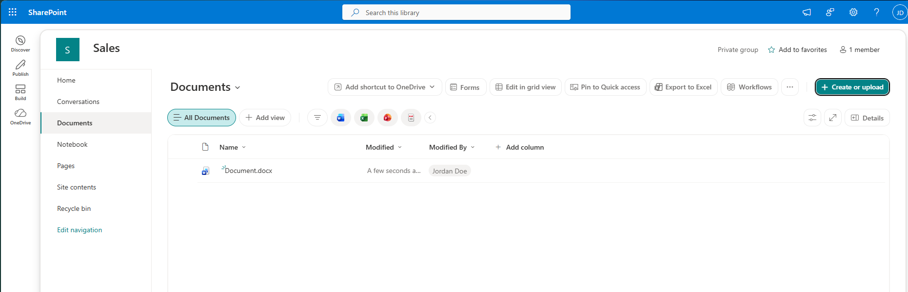
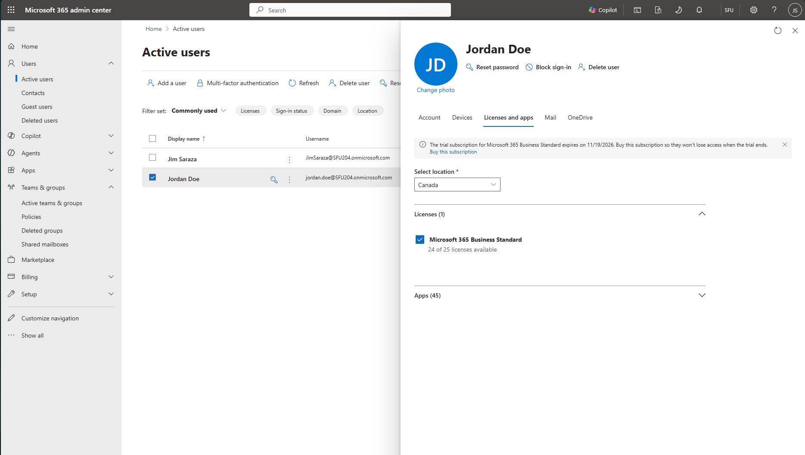
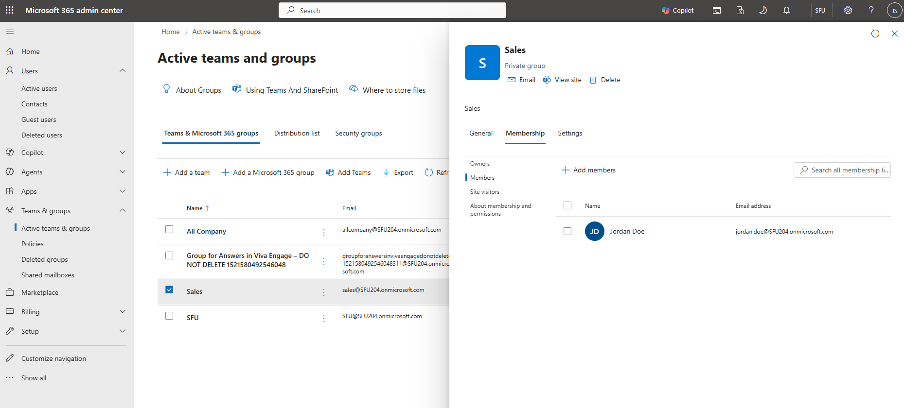

# TICKET-009 — New starter: Microsoft 365 account, mailbox and SharePoint access

| Field | Value |
|---|---|
| Priority | P4 |
| Category | Service request / Onboarding |
| Reported by | HR, on behalf of Jordan Doe (Sales, new hire) |
| Date | 2026-10-22 |
| Environment | Personal Microsoft 365 Business Standard trial tenant (SFU204.onmicrosoft.com), not affiliated with Simon Fraser University |

## Request
HR is onboarding a new user account for the new hire, Jordan Doe, in the sales department. HR needs to add him to the department and assign Jordan with his own email. 

## Pre-checks
1. License available. 23 of 25 Business Standard licenses available.
     
2. Duplicate accounts. The wizard accepted jordan.doe with no conflict
3. Simulated in the lab. However, a call to the hiring manager qualifying the ticket. 

## Actions taken
1. Created the Sales Group: private, no Team. Creates the SharePoint site.
2. Created Jordan with an auto-generated password, required to change when first signing in, location Canada, gave him a business standard license, and a user role (no admin access) and department Sales.
3. Added him to the Sales Group. That's how he'd get to the site.
4. The mailbox was created automatically once the license was assigned.
5. the temporary password wasn't recorded, so you reset it before first signing in.

## Verification, from the user's side
<!-- What Jordan could do: sign in and change his password, MFA prompt, send mail, create a file on the Sales site; and what he couldn't do: admin centre denied. Link each screenshot. -->
- Signed in from a private window and cchanged his password from first sign in. MFA was prompted and it was setup using a qr code with microsofts authenticate.
- Mail works both ways, sent "Test From Jordan" to admin account and admin replied. 
- Sharepoint works. Document.docx in Sales -> Documents 
-  

## Resolution
Admin confirms with user Jordan Doe that he has logged in. Resolved as "fixed"; closed

## Notes / prevention
1. Lab limitation: the account is cloud only. Real situation, user created in AD on premises and synced to Microsoft 365 with Entra Connect. Lab is isolate so it cannot sync
2. Temporary password must be treated as a credential as it is a temporary login for the user
3. Prevention: Deliver temporary password to the manager immediately through a secure channel.
<!-- 1. Lab limitation: the account is cloud-only. In a real company it would be created in on-premises AD and synced to Microsoft 365. Say why your lab can't do that.
     2. Anything that went wrong, e.g. the temporary password wasn't recorded and you reset it.
     3. One improvement: an onboarding checklist, or creating the account early with sign-in blocked until the start date. -->
